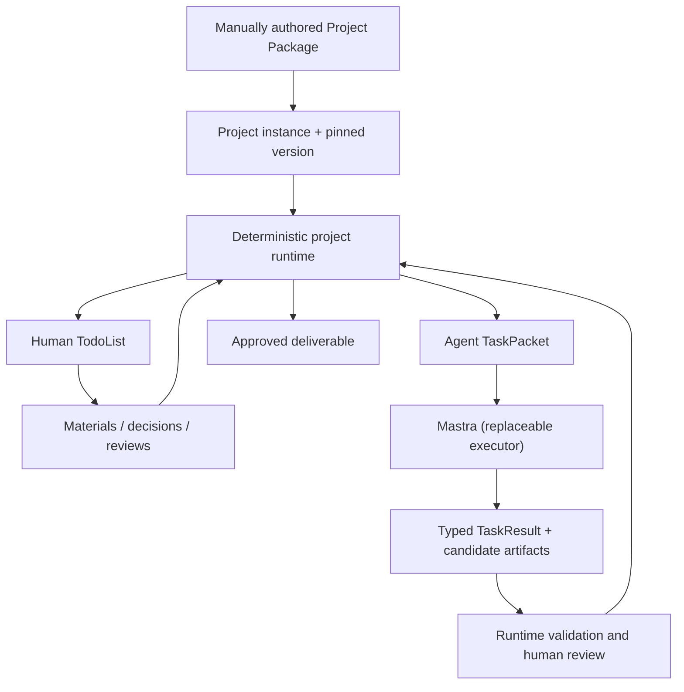

# Human Harness

**A project-first workspace for humans and AI agents.**  
Define a project once, then let people and agents work through its real-world dependencies—without relying on a long chat to remember what comes next.

**[中文说明](docs/README.zh-CN.md)** · [Protocol 1.0](docs/protocol/human-harness-1.0.md) · [Codex-first design](docs/codex-reference.md) · [Interoperability roadmap](docs/interoperability.md) · [Land investigation example](examples/land-investigation.hh.json)

> **Status: early local-development prototype.** The task engine and no-key demo workflow work; real model calls, third-party connectors, office document parsing, and production deployment are **not verified or supported**. This repository is not a regulatory compliance tool.

## Why does this exist?

Most agent apps start with a chat: the user asks for something, and the agent decides the next step. Many real projects are different. They involve source documents that do not exist yet, outside organizations, human approvals, and work that must pause until the right evidence arrives.

For example, a land-contamination investigation may eventually need laboratory test and quality-control reports. **Those are not sensible initial upload requirements.** The sampling plan needs professional approval first; an institution then performs the work; only after that can its actual reports be requested and reviewed.

Human Harness owns the **project state and workflow**. An existing agent framework performs individual, authorized tasks. Neither the model's conversation memory nor its own claims decide whether evidence has been accepted.

### The central loop

1. **Author or import a project template manually.** Define the workflow, required materials, decision gates, capabilities, and intended outputs.
2. **Create a project.** The project pins the template version and a content digest.
3. **Work on what is actionable now.** Human TodoList and Agent work are two views of the same project, not competing checklists.
4. **Submit materials and review results.** Uploading a file does *not* automatically verify its contents.
5. **Advance when conditions are met.** Professional choices and external milestones activate later work.
6. **Review and export actual deliverables.** No fake PDF/DOCX outputs when a renderer is unavailable.

A future material requirement may be recorded on day one but remains outside the current user's TodoList until its activation condition is satisfied.

## What makes it different?

| Chat-centric agent | Human Harness |
| --- | --- |
| Conversation is the primary work unit | A persistent project instance is the work unit |
| Model proposes and often controls the next step | The project runtime activates work from declared conditions |
| Files are usually immediate context | Materials have producers, due stages and acceptance states |
| Human input is an interruption to the chat | Human decisions, external handoffs and approvals are first-class tasks |
| Tool use is tied to an agent implementation | Agent execution is behind a replaceable task-packet interface |
| Output may be accepted when the model says "done" | Outputs pass runtime checks and explicit review gates |

**This is not a new foundation model, a replacement for Mastra, a template marketplace, or a general web-search agent.**

## Current capabilities and limits

| Area | Available in this branch | Not available yet |
| --- | --- | --- |
| Templates | Manually create, copy, edit and import strict Protocol 1.0 JSON | ZIP packages with binary assets; public search/catalog |
| Project execution | Persisted tasks, conditional branches, decisions, external milestones | General dynamic task creation; upstream change invalidation |
| Human–AI collaboration | Human TodoList, Agent task queue, approve/reject/retry | Multi-user identity, permissions, secure public hosting |
| Materials | Save files and text; request/receive/accept/reject; track versions | Robust PDF/DOCX/CAD parsing, content-level professional verification |
| Agent executor | One-task-at-a-time Mastra adapter; simulated no-key mode | Real provider/API smoke-test guarantee; automated background workers |
| Outputs | Reviewed Markdown/JSON downloads | Production DOCX/PDF compilation and publication |
| Integration | Internal typed TaskPacket/TaskResult contracts | MCP client/server, portable Agent Skills, host-platform adapters |

We are **designing** interoperability with MCP and Agent Skills; they are **not installed as project capabilities** in this version.

## Try it locally

Requirements: Node.js **22.19 recommended** (the package declares Node >=22.13), npm, and a computer with persistent local storage.

**The implementation is currently in an open pull request, not yet on `main`.** Until it is merged, check out the development branch:

```bash
git clone https://github.com/6jingyong/human-harness.git
cd human-harness
git switch feat/project-first-foundation
npm install
cp .env.example .env.local
npm run dev
```

On Windows, use PowerShell `Copy-Item .env.example .env.local` instead of `cp` if needed. Visit **http://localhost:3000**.

The default `HH_EXECUTOR=demo` calls **no model or outside service**. The generated text is clearly marked as simulated, so it tests the workflow rather than actual research quality.

For real Mastra calls, set `HH_EXECUTOR=mastra`, choose an **available model identifier** in `HH_MODEL`, and configure the relevant provider credentials. Actual API access and model availability have not been smoke-tested in this repository.

### Walk through the built-in example

Select **土地污染调查 · 项目运行示例** (land-contamination investigation).

1. Create a project and submit its identity, original boundary file, and intended land-use basis.
2. Manually accept each received item. This is a **workflow acknowledgment**, not independent evidence validation.
3. Run the evidence-inventory task and approve or reject its candidate result.
4. Choose the professional decision: finish after stage one or enter sampling.
5. In the sampling branch, approve the proposed plan, record commissioning, and **only after actual external work is finished** confirm the institutional milestone.
6. Only then do field records, laboratory results and QC evidence become actionable upload requirements.
7. Review the resulting **internal Markdown drafts**. The example does not conduct real sampling or produce a signed regulatory report.

The example's institutional work and professional approvals must be performed by real people/organizations in actual use. Do **not** represent the demo output as fieldwork, GIS evidence, laboratory analysis or a valid regulatory conclusion.

## How it works



The canonical internal protocol uses:

- **`hh.package/1`** — project template: stages, material requirements, work steps, decisions, capabilities and output contracts.
- **`hh.task/1`** — scoped job given to an executor, referencing only authorized evidence and tools.
- **`hh.result/1`** — typed proposals and candidate artifacts; an agent cannot directly commit authoritative decisions or completed state.

A **MaterialRequirement** expresses *what must eventually exist*. A **WorkItem** expresses *who can do what now*. A **MaterialArtifact** expresses *what actually arrived*. These must remain separate.

The project runtime is responsible for state transitions. Mastra is an adapter for executing a job, not the source of truth.

### Materials are processed according to the template

A template should eventually define **how to identify a source file, which fields to extract, how to verify those fields, and when to ask a human to resolve an issue**. For example, a laboratory report may require sample IDs, measurements, units, and source-table positions, then a cross-check against sampling records. A PDF upload alone does not establish that any of those checks passed.

**Human TodoList is the single business-review interface**: uploading materials, resolving extraction conflicts, examining outputs, and making professional decisions are all ordinary Human WorkItems. No separate project approval subsystem is planned. Codex's own tool permissions and sandbox controls are unrelated execution-layer protections.

See the [template material-processing design](docs/template-material-processing.md). **These extraction/verification policies are planned, not yet supported by the current JSON schema or parser.**

### Source layout

```text
src/
  protocol/        Canonical package / task / result validators
  core/            Workflow activation, decisions, evidence review, SQLite store
  executors/       Mastra worker adapter
  app/             Next.js workspace and /api/v1 routes
examples/          Runnable project package
docs/              Protocol, domain blueprint, interoperability research
tests/             Protocol and project-lifecycle regression tests
```

All state is local: `.human-harness/protocol-v1.sqlite` and `.human-harness/uploads/`. These files are git-ignored. Older experimental `projects.sqlite` data is not migrated or overwritten; back it up before any manual cleanup.

## Primary agent-harness reference: Codex

We are using the **open-source Codex harness as the main architectural reference** for the next stage. It already provides an agent loop, context/session lifecycle, tool execution, approval and sandbox boundaries, and programmatic integration through **Codex SDK, `codex exec` and app-server**. These are the pieces to study **before** inventing another executor runtime.

**Current code still runs on Mastra. Codex is a research/integration direction, not an installed or tested executor.** Human Harness continues to own project templates, pending human inputs, evidence acceptance and project-level decisions. A Codex thread/turn cannot replace that project ledger.

Read the [Codex-first design note](docs/codex-reference.md) and the more specific [app-server / Skills / permissions study](docs/codex-app-server-study.md). These documents define a proposed execution-adapter boundary; neither a Codex adapter nor any PDF/DOCX plugin is installed yet.

## First reproducible document-method experiment (synthetic data)

We have added a **standalone, reproducible PDF/DOCX method-contract experiment** (not yet integrated with Human Harness): two synthetic original-format documents, a declarative material-method JSON file, a read-only extraction/check runner, and a Codex-discoverable demo Skill. It identifies a deliberate sample-point mismatch and a missing measurement unit, emitting **two source-linked Human Todo proposals**.

This demonstrates how templates could specify recognition → field extraction → cross-document verification → issue-to-Human-Todo, **not** production document parsing or Codex/MCP interoperability.

- [Experiment and run instructions](experiments/document-methods/README.md)
- [Measured results and limitations](docs/document-methods-experiment.md)
- [Demo Skill](.agents/skills/document-evidence-demo/SKILL.md)

## Native Codex Plugins first

**The next integration milestone is to consume existing native Codex plugins**, not to build our own PDF/DOCX reader. Human Harness will provide a scoped task and its expected outputs; Codex will discover and use installed Skills/MCP tools. The template retains only the *business requirement* (which fields, which checks, what to do if unresolved). If a compatible plugin is missing, the user can install/connect it through the normal Codex flow.

Codex's app-server exposes plugin inventory and skill/MCP readiness APIs. A separate native Plugin package for Human Harness itself is an **optional later distribution mode**, not the prerequisite for using other plugins. No Codex plugin adapter is implemented here yet.

Read the [native Codex plugin strategy](docs/codex-native-plugins.md) for the actual interfaces, current limitations, and the one-call smoke test. The existing PDF/DOCX extraction experiment is preserved only as a **historical method-contract test**, not the next product implementation.

## Plugin and platform direction

We want **capabilities to travel across mainstream agent environments**, not to tie PDF/DOCX readers or other tools to one chat product.

The proposed separation is:

- **Core capability**: a headless reader, parser, document generator, GIS operation, etc., with explicit inputs, outputs, provenance and error contracts.
- **MCP adapter**: expose those callable capabilities over appropriate local or remote MCP transports for compatible agent hosts.
- **Agent Skill**: bundle portable workflow instructions, references and optional scripts in a `SKILL.md` package.
- **Host-specific adapters**: optional setup/configuration for ChatGPT, Claude Code, Codex, Gemini CLI, Cursor and other supported hosts.
- **Human Harness adapter**: use the same capability inside a project, where evidence approval and timing are controlled by the project runtime.

**MCP, Agent Skills and vendor-specific plugins are not identical or universally interchangeable.** The goal is one capability implementation with multiple tested adapters, not a promise that every host supports every feature.

The first planned interoperability case is **document reading**: PDF and DOCX → a structured, cited document representation with pages/sections, tables, original-source references and explicit extraction uncertainty. Parsing text is not the same as verifying its meaning. See the [interoperability roadmap](docs/interoperability.md) for research sources and acceptance criteria.

## Development, safety and contribution

```bash
npm run typecheck
npm test
npm run build
```

Pull requests and reproducible bug reports are welcome. Particularly useful contributions include portable document-read adapters, sample document fixtures with permission to redistribute, protocol validation cases, and workflow examples with clear acceptance rules.

Before contributing a capability, specify **where it runs, what it can access, which hosts it supports, and how failures are reported**. No untrusted scripts may be executed merely by importing a project package.

**Security:** local-development prototype only. There is no user authentication, tenant isolation, document-parsing sandbox, full permission policy, durable worker queue or production hardening. Do not put sensitive customer documents into an exposed instance.

**License:** [MIT](LICENSE). This repo is currently an early-stage application rather than a published SDK or independently deployable plugin.

---

**Principle:** *The template defines the plan; the project records reality; people provide and approve evidence; mature agents execute scoped work.*
