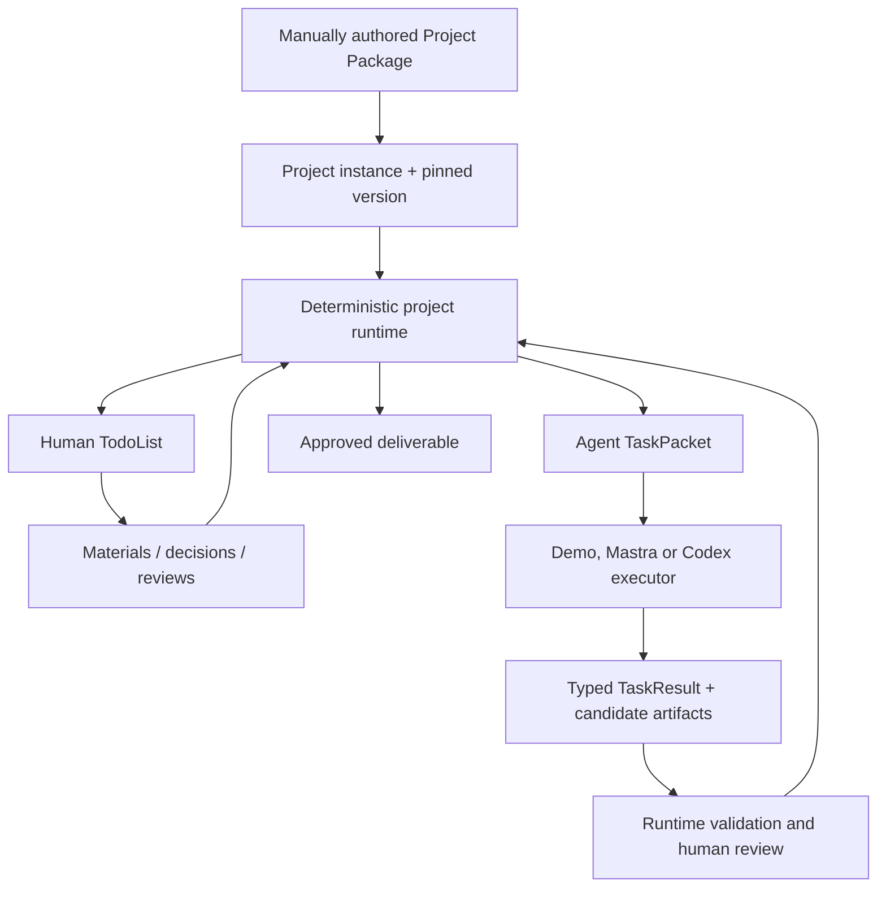

# Human Harness

**A project-first workspace for humans and AI agents.**  
Define a reusable workflow, then use it to schedule people and agents against project deadlines, available hours, and outside lead times. Human Harness keeps the project plan and review history. Its Codex adapter uses the open-source Codex app-server to execute eligible Agent tasks and access capabilities installed in Codex.

**[通用文档交接 MVP](docs/mvp-document-handoff.md)** · **[中文说明](docs/README.zh-CN.md)** · **[Codex Edition V1 roadmap](docs/roadmap-codex-v1.md)** · [Protocol 1.0](docs/protocol/human-harness-1.0.md) · [Codex-first design](docs/codex-reference.md) · [Interoperability roadmap](docs/interoperability.md) · [Land investigation example](examples/land-investigation.hh.json)

> **Early local-development prototype.** The task engine and no-key demo are runnable. Skill selection has automated protocol coverage. A real Codex CLI 0.171.0 and a synthetic local MCP server passed the browser workflow from template selection to Human review and downstream handoff. Authenticated model runs, third-party connectors, and document extraction by installed Skills still need live verification. Word export produces review copies from approved Markdown.

The first reference project template, [land investigation](project-templates/land-investigation/), opens directly in the package editor via the menu action 「打开环评参考模板」. It covers project launch, external work, evidence review, and delivery of an approved internal report in Markdown or Word. The default template list contains general-purpose examples. Existing projects use their saved package snapshots.

The [project requirements workflow](docs/project-coordination.md) materializes optional outside work and follows it through acceptance in the Human Todo.

The [project planning view](docs/project-planning.md) schedules the same tasks against workday capacity, records a baseline and identifies actionable delays.

The built-in [general project templates](docs/README.zh-CN.md#通用项目模板) include report writing, project kickoff, meeting minutes and actions, and project retrospectives. They produce reviewed Markdown and Word deliverables.

The local project ledger tracks cash, contract receivables and actual human time. It reads external waiting from project events, compares related projects or a historical baseline, and rolls up company cash by currency.

## Why does this exist?

Most agent apps start with a chat: the user asks for something, and the agent decides the next step. Many real projects are different. They involve source documents that do not exist yet, outside organizations, human approvals, and work that must pause until the right evidence arrives.

For example, a land-contamination investigation may eventually need laboratory test and quality-control reports. **Those are not sensible initial upload requirements.** The sampling plan needs professional approval first; an institution then performs the work; only after that can its actual reports be requested and reviewed.

Human Harness owns the **project state and workflow**. An existing agent framework performs individual, authorized tasks. Neither the model's conversation memory nor its own claims decide whether evidence has been accepted.

### The central loop

1. **Author or import a project template.** Use the visual editor to connect Human tasks, AI and program execution, and review handoffs. Set material gates, conditions, estimates, and deliverables on the same package that drives project execution.
2. **Create a project.** The project pins the template version and a content digest.
3. **Work on what is actionable now.** Human TodoList and Agent work are two views of the same project, not competing checklists. On the home screen, Human TodoList is the left vertical list and Agent TodoList is the right vertical list. Agent tasks fold by template-defined owner and by status. Click any task to expand its input/review controls. The hamburger menu opens project/template controls and a separate project materials page with original files, template-specific requirements and reviewed Agent interpretations. Source-referenced semantic notes are optional and become reusable only after human approval and only for the currently accepted source revision.
4. **Submit materials and review results.** Uploading a file does *not* automatically verify its contents.
5. **Advance when conditions are met.** Professional choices and external milestones activate later work.
6. **Review and export actual deliverables.** No fake PDF/DOCX outputs when a renderer is unavailable.

A future material requirement may be recorded on day one but remains outside the current user's TodoList until its activation condition is satisfied.

## What makes it different?

| Chat-centric agent | Human Harness |
| --- | --- |
| Conversation is the primary work unit | A persistent project instance is the work unit |
| Model proposes and often controls the next step | The project runtime activates work from declared conditions |
| Files are usually immediate context | Materials have producers, due stages and acceptance states |
| Human input is an interruption to the chat | Human decisions, external handoffs and approvals are first-class tasks |
| Tool use is tied to an agent implementation | Agent execution is behind a replaceable task-packet interface |
| Output may be accepted when the model says "done" | Outputs pass runtime checks and explicit review gates |

**This is not a new foundation model, a replacement for Mastra, a template marketplace, or a general web-search agent.**

## Current capabilities and limits

| Area | Available now | Not available yet |
| --- | --- | --- |
| Templates | Create, copy and edit two-lane workflows visually, or import strict Protocol 1.0 JSON | ZIP packages with binary assets; public search/catalog |
| Project execution | Persisted tasks, conditional branches, decisions, external milestones, and selective reopening after an accepted source revision changes | General dynamic task creation |
| Human–AI collaboration | Human TodoList, Agent task queue, approve/reject/retry | Multi-user identity, permissions, secure public hosting |
| Materials | Save files and text; request/receive/accept/reject; track versions | Robust PDF/DOCX/CAD parsing, content-level professional verification |
| Agent executor | Demo, Codex, Ollama and Mastra adapters, plus local bounded auto-dispatch | Live Codex model verification and production worker recovery |
| Outputs | Reviewed Markdown/JSON downloads and opt-in Word review copies of approved Markdown | Production report compilation and publication |
| Codex integration | Installed Plugin and Skill inventory, optional MCP readiness, Skill selection per Agent task, and a direct query to one locally approved read-only MCP tool | Plugin installation from the workbench and model-selected MCP tools |

## Local graphical workbench

Install Node.js 22.19 or later. [Download and extract the main branch](https://github.com/6jingyong/human-harness/archive/refs/heads/main.zip) or clone it with Git.

```bash
git clone https://github.com/6jingyong/human-harness.git
cd human-harness
npm ci
npm run local
```

Windows users can double-click **Start-Human-Harness.cmd** in the checkout. It installs missing dependencies on first launch. The launcher starts the workbench on the loopback interface and opens the default browser. The usual address is **http://127.0.0.1:3000**. To use another port, set `PORT`. To start without opening a tab, run `npm run local -- --no-open`.

Choose a project template on the home screen. The model button at the top right opens the workspace model settings. A saved choice applies across projects to newly started Agent runs and persists after restarting. Task details show the model recorded for that run. [Model picker screenshot](docs/images/local-model-picker.webp).

| Model source | Setup |
| --- | --- |
| Demo | Ready on first launch. Exercises the workflow without a model account. |
| Codex | Install and log into the local Codex CLI. Choose a model returned by the CLI or use its default. |
| Ollama | Start Ollama on `127.0.0.1:11434` and install a model that supports structured output. Refresh the list and select the model you installed. |
| Mastra | Configure your provider credentials in the environment or `.env.local`, then enter the provider/model ID. To suggest several IDs in the picker, set `HH_MODELS` to a comma-separated list. |

The default `HH_EXECUTOR=demo` calls **no model or outside service**. The generated text is clearly marked as simulated, so it tests the workflow rather than actual research quality.

For real Mastra calls, set `HH_EXECUTOR=mastra`, choose an **available model identifier** in `HH_MODEL`, and configure the relevant provider credentials. Actual API access and model availability have not been smoke-tested in this repository.

Run `npm run codex:capabilities` to list installed Plugins and available Skills through the local Codex app-server without running a model. Add `-- --mcp` to discover connection and tool status from configured MCP servers. For project execution, install and authenticate Codex CLI, set `HH_EXECUTOR=codex` (optional `HH_CODEX_MODEL`), and run `npm run codex:smoke` when ready to use model quota. An Agent step can select Skills using `codexSkills`, including a Plugin-provided Skill such as `documents@local/pdf` when that ID is installed. Accepted PDF/DOCX originals additionally require `HH_CODEX_DOCUMENTS=1`. See [Codex capability discovery and task binding](docs/codex-native-plugins.md) and the [live A/B/C evaluation guide](docs/eia-codex-live-stage-eval.md).

### Verify a read-only Codex MCP tool

The synthetic lookup below exercises a configured local Codex app-server without a model turn. Add the server to your local Codex configuration and replace the path with the absolute path to your clone.

```toml
[mcp_servers.hh_smoke]
command = "node"
args = ["/absolute/path/to/human-harness/tests/fixtures/read-only-mcp-server.mjs"]
```

```bash
npm run codex:capabilities -- --mcp
HH_CODEX_MCP_READ_ONLY=hh_smoke/sample_lookup npm run codex:mcp:smoke -- hh_smoke sample_lookup '{"sampleId":"DEMO-01"}'
```

For a project, set `HH_EXECUTOR=codex` and `HH_CODEX_MCP_READ_ONLY=hh_smoke/sample_lookup` in `.env.local`, then restart the workbench. In the template editor, select an Agent task and enable the read-only lookup under **Codex MCP**. Click **查看本机可用工具**, pick `hh_smoke/sample_lookup`, and enter `{"sampleId":"DEMO-01"}` as its fixed arguments. You can also enter the two names by hand when authoring a template for another machine. The runtime checks the tool again when the task is ready. Its result enters Human Todo for review.

With the synthetic server registered, `npm run build`, `npx playwright install chromium`, and `npm run test:codex:mcp` exercise the full browser workflow on port 3101 using a temporary project database. The test saves a template, runs the lookup through the Codex CLI, inspects the returned record, approves it in Human Todo, and checks that the dependent handoff becomes actionable. The recorded run used no model turn or project originals. [GitHub Actions verification](https://github.com/6jingyong/human-harness/actions/runs/45167224596/job/137667201247).

### Walk through the built-in example

Select **土地污染调查 · 项目运行示例** (land-contamination investigation).

1. Create a project and submit its identity, original boundary file, and intended land-use basis.
2. Manually accept each received item. This is a **workflow acknowledgment**, not independent evidence validation.
3. Run the evidence-inventory task and approve or reject its candidate result.
4. Choose the professional decision: finish after stage one or enter sampling.
5. In the sampling branch, approve the proposed plan, record commissioning, and **only after actual external work is finished** confirm the institutional milestone.
6. Only then do field records, laboratory results and QC evidence become actionable upload requirements.
7. Review the resulting **internal Markdown drafts**. The example does not conduct real sampling or produce a signed regulatory report.

The example's institutional work and professional approvals must be performed by real people/organizations in actual use. Do **not** represent the demo output as fieldwork, GIS evidence, laboratory analysis or a valid regulatory conclusion.

## How it works



The canonical internal protocol uses:

- **`hh.package/1`** — project template: stages, material requirements, work steps, decisions, capabilities and output contracts.
- **`hh.task/1`** — scoped job given to an executor, referencing only authorized evidence and tools.
- **`hh.result/1`** — typed proposals and candidate artifacts; an agent cannot directly commit authoritative decisions or completed state.

A **MaterialRequirement** expresses *what must eventually exist*. A **WorkItem** expresses *who can do what now*. A **MaterialArtifact** expresses *what actually arrived*. These must remain separate.

The project runtime is responsible for state transitions. **The shared runner** (`src/executors/runner.ts`) reserves tasks, selects the authorized evidence references, validates the candidate result and commits the next review state. The replaceable adapter (`src/executors/contracts.ts`) receives only the scoped task/evidence/feedback and returns a typed candidate; it never receives the full project snapshot or the private upload path.

The Demo, Mastra, and Codex adapters share this boundary. The Codex adapter creates a local thread per run and records its identity and typed candidate result. Model-backed tasks use a turn in that thread. Direct MCP lookups call the tool without opening a model turn. CI checks the app-server protocol against a fixture. [P0–P5 milestone plan](docs/roadmap-codex-v1.md).

### Materials are processed according to the template

A template should eventually define **how to identify a source file, which fields to extract, how to verify those fields, and when to ask a human to resolve an issue**. For example, a laboratory report may require sample IDs, measurements, units, and source-table positions, then a cross-check against sampling records. A PDF upload alone does not establish that any of those checks passed.

**Human TodoList is the single business-review interface**: uploading materials, resolving extraction conflicts, examining outputs, and making professional decisions are all ordinary Human WorkItems. No separate project approval subsystem is planned. Codex's own tool permissions and sandbox controls are unrelated execution-layer protections.

See the [template material-processing design](docs/template-material-processing.md). **These extraction/verification policies are planned, not yet supported by the current JSON schema or parser.**

### Source layout

```text
src/
  protocol/        Canonical package / task / result validators
  core/            Workflow activation, decisions, evidence review, SQLite store
  executors/       Demo, Codex, Ollama and Mastra adapters
  app/             Next.js workspace and /api/v1 routes
examples/          Runnable project package
docs/              Protocol, domain blueprint, interoperability research
tests/             Protocol and project-lifecycle regression tests
```

All state is local: `.human-harness/protocol-v1.sqlite` and `.human-harness/uploads/`. These files are git-ignored. Older experimental `projects.sqlite` data is not migrated or overwritten; back it up before any manual cleanup.

## Primary agent-harness reference: Codex

We are using the **open-source Codex harness as the main architectural reference** for the next stage. It already provides an agent loop, context/session lifecycle, tool execution, approval and sandbox boundaries, and programmatic integration through **Codex SDK, `codex exec` and app-server**. These are the pieces to study **before** inventing another executor runtime.

**Current code supports a protocol-tested Codex adapter in addition to the Mastra/demo prototype; actual model calls have not been verified on a logged-in Codex host.** Human Harness continues to own project templates, pending human inputs, evidence acceptance and project-level decisions. A Codex thread/turn cannot replace that project ledger.

Read the [Codex-first design note](docs/codex-reference.md) and [app-server / Skills / permissions study](docs/codex-app-server-study.md). The app-server adapter supports text tasks plus an opt-in PDF/DOCX Skill discovery/invocation bridge for approved originals. Plugin and MCP configuration stay in Codex. A live Skill and model smoke test remains required.

## Parallel-first by default

Human Harness is not a single root-agent conversation that serially drives a project. The **project dependency graph** makes independent Human Todo items and Agent WorkItems actionable at the same time. Policy-authorized ready Agent tasks should **auto-dispatch concurrently within resource/permission limits**, while Human Todo stays independently actionable; the user should not have to click Run for every Agent task. Codex may independently use subagents *inside* an individual run, but that is a different level of parallelism.

**Current status (local prototype):** the task-first GUI combines two queues with one direct input/review panel; the no-key Demo flow has passed Chromium browser E2E tests. Project-level auto-dispatch now runs eligible independent Agent WorkItems in the background with a per-project cap (default 2), and Human Todo actions are no longer blocked by another task's model call. Run state is persisted; the GUI polls every 2 seconds and offers pause/resume. **Limitations:** the worker is an in-process Node service started by web requests, not a standalone durable worker or multi-process queue. On first boot it marks old in-flight tasks interrupted without auto-retrying them; locally owned tasks may be cancelled and late results are rejected. Real concurrent Codex runs are unverified. Mastra provider calls may continue remotely after local cancellation. See [parallel-first contract](docs/parallel-first.md) and [Agent lanes and semantic evidence](docs/agent-groups-and-semantics.md). Bounded Agent questions about template-declared materials now become Human Todo items; answers resume the same WorkItem without pretending new evidence was validated. See [the private-source EIA replay pilot](docs/eia-private-source-replay.md) for a real-file provenance audit with synthetic Harness CI, and [Agent → Human → Agent handoff](docs/agent-to-human-request-loop.md), [review-gated source replacement](docs/material-version-replacement.md), and [template-owned methods and multi-Agent pilot](docs/template-methods-pilot.md). Templates may define material acquisition/extraction/verification and per-work-item checklists; the engine validates checklist IDs and authorized references but does not self-certify model facts. For reproducible browser verification run `npm run build`, `npx playwright install chromium` and `npm run test:browser` (CI also installs system dependencies).

## One project core, more than one possible ecosystem

Human Harness needs **Codex's local Agent/Skill/Plugin ecosystem**, not Codex Cloud or hosted collaboration features. The initial target is a **local Codex execution adapter**; online model APIs or external tools remain optional choices made by the user, not mandatory Codex product integrations.

A **future China-oriented profile** may use TencentCloud's **Octop Harness / Octop** runtime and its domestic document, IM and connector ecosystem. The project templates, material methods, evidence state and Human TodoList should remain unchanged. Octop's plugin format is not assumed to be interchangeable with Codex Plugins.

This is a design direction, **not** an existing second distribution, fork, or working adapter. See [ecosystem distribution strategy](docs/ecosystem-distributions.md).

## Native Codex Plugins first

Install and connect Plugins, Skills, and MCP servers through Codex. A Human Harness template records the business requirements and can bind an Agent task to an available Skill or a direct MCP lookup.

Read the [native Codex plugin strategy](docs/codex-native-plugins.md) for the app-server interfaces and current limits.

## Plugin and platform direction

We want **capabilities to travel across mainstream agent environments**, not to tie PDF/DOCX readers or other tools to one chat product.

The proposed separation is:

- **Core capability**: a headless reader, parser, document generator, GIS operation, etc., with explicit inputs, outputs, provenance and error contracts.
- **MCP adapter**: expose those callable capabilities over appropriate local or remote MCP transports for compatible agent hosts.
- **Agent Skill**: bundle portable workflow instructions, references and optional scripts in a `SKILL.md` package.
- **Host-specific adapters**: optional setup/configuration for ChatGPT, Claude Code, Codex, Gemini CLI, Cursor and other supported hosts.
- **Human Harness adapter**: use the same capability inside a project, where evidence approval and timing are controlled by the project runtime.

**MCP, Agent Skills and vendor-specific plugins are not identical or universally interchangeable.** The goal is one capability implementation with multiple tested adapters, not a promise that every host supports every feature.

The first planned interoperability case is **document reading**: PDF and DOCX → a structured, cited document representation with pages/sections, tables, original-source references and explicit extraction uncertainty. Parsing text is not the same as verifying its meaning. See the [interoperability roadmap](docs/interoperability.md) for research sources and acceptance criteria.

## Development, safety and contribution

```bash
npm run typecheck
npm test
npm run build
```

Pull requests and reproducible bug reports are welcome. Particularly useful contributions include native Codex-plugin integration tests, protocol validation cases, and workflow examples with clear acceptance rules. We should not duplicate document parsers already available through suitable plugins.

Before contributing a capability, specify **where it runs, what it can access, which hosts it supports, and how failures are reported**. No untrusted scripts may be executed merely by importing a project package.

**Security:** local-development prototype only. There is no user authentication, tenant isolation, document-parsing sandbox, full permission policy, durable worker queue or production hardening. Do not put sensitive customer documents into an exposed instance.

**License:** [MIT](LICENSE). This repo is currently an early-stage application rather than a published SDK or independently deployable plugin.

---

**Principle:** *The template defines the plan; the project records reality; people provide and approve evidence; mature agents execute scoped work.*


### Zero-token deterministic work items

Protocol `kind: "script"` now supports a single safe, built-in `hh.render.markdown` capability for **internal** Markdown assembly from reviewed upstream outputs. The renderer never reopens original sources or evaluates template-supplied code; it copies even deliberately incorrect approved conclusions verbatim, then returns a candidate for normal Human review. See [architecture review and deferred Codex task](docs/architecture-review-and-todo-20261109.md) and importable example `examples/approved-conclusions-assembly.hh.json`. Real authenticated Codex A→B→C tests are deferred to [Issue #4](https://github.com/6jingyong/human-harness/issues/4) while model quota is unavailable. This is not DOCX/PDF support.
