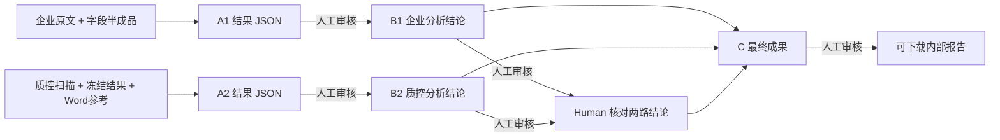

# EIA A→B→C 流水线并行功能验收（2026-11-09）

## 核心判断

用户期望的 **A：原始资料/已有半成品→结构化结果；B：已审核结果→分析结论；C：已审核结论→最终成果文件** 是三个处理阶段，而非三位 Agent 分别审查不同来源。单份资料链路必须串行；多份资料之间可做流水线并行。当前专用模板已安装，保留旧环评来源核查模板作为对照。

新模板：`examples/eia-abc-pipeline.hh.json`，项目模板 ID `eia-abc-pipeline`。

## 明确的依赖图

这不是 A、B、C 同时处理同一份资料。可以出现 **A2 仍运行、B1 同时开始** 的跨分支流水线并行。每一个由同一模型执行的 TaskExecutor 仍可以是短生命周期独立会话；Agent A/B/C 的角色当前由模板分组和授权数据确定，不是长驻多实例模型账户。

## 发现的真实功能问题与修复

1. **原环评模板是按企业/质控分工，无法验证三阶段职责。** 新模板分成 A1、A2、B1、B2、Human 决定、C；A 的结果输出 JSON，B/C 输出 Markdown。
2. **下游越权复读原件的风险。** 新模板为 B/C 设置空 `needsMaterials`，只依赖直接上一阶段的已审产物；B1 看不到企业原始文件，B2 看不到质控 PDF，C 看不到任何原件或 A 阶段 JSON。
3. **并行只是界面上有两项任务，缺少执行证据。** `tests/eia-abc-pipeline.test.ts` 使用真正的 `LocalScheduler` 与异步阻塞门验证 A2 running 时 B1 running，`activeCount===2`，先后放行和依赖均正确。
4. **A 若宣称输出 JSON 但交付文本，可能被当成果接力。** Runner 现在拒绝不合法 JSON / 非 JSON 对象，结果不会进入候选审核。
5. **Demo 执行器无法返回 JSON 导致 A 阶段卡死。** 为 JSON 契约返回明确标注 `demo:true, verified:false` 的示例对象；绝不伪装有真实提取和专业验证。
6. **B/C 因不直接依赖原件，其成果在旧资料页不可见。** 资料库新增全局“项目成果文件”区，统一展示 A、B、C 各自的候选、已审核和失效状态；最终 C 可由审核后链接实际下载。
7. **未经批准的 A/C 结果不能被下游复用或当成果下载。** Runner 和下载 API 仍通过人类审核与当前输出版本守门；A 被退回后，B 保持 blocked，批准修订后才可继续。

## 自动化验收与可重复执行

- 单元与集成测试：**83/83 通过**。
- Chromium Playwright：**7/7 通过**。浏览器中创建 EIA A/B/C 项目、提交 TXT/JSON/PDF/DOCX 合成文件、按 A→B→Human→C 审核、从成果区真实 HTTP 下载 C 的 `eia-internal-final.md`。
- GitHub Actions：check **#42551249967**、gui-smoke **#42551249971**、document-methods-spike **#42551249977** 全部成功。
- `tests/eia-abc-pipeline.test.ts` 另验证真正的调度重叠、下游输入隔离、JSON 输出约束以及未批准成果不得下载。
- 新截图：`human-harness-abc-home.png`、`human-harness-abc-a-result.png`、`human-harness-abc-b-conclusion.png`、`human-harness-abc-c-output.png`。使用 Demo 和合成资料，界面会明确标注。

## 尚未证明的事项

- 没有在本次 GitHub Actions 中接入实际已认证 Codex/视觉 Skill。**模型的真实抽取准确率、分析是否充分、最终文字质量均未验收**。不能把 83/83 和 7/7 解读成真实环评报告质量达标。
- **C 目前实际输出的是可下载的 Markdown 文件。** Word 模板生成仍缺独立确定性 DOCX renderer；不能声称现已交付正式 Word 环评报告。
- B/C 的“仅凭上一阶段结果”的权限由项目步骤的输入作用域严格限制；对 AI 输出的“是否偷下结论、是否颠倒事实”，仍要依靠项目模板、测试用例和人类审核。
- 环评资料库中的真实文件仍作为私有测试输入，不被提交到公共 GitHub 仓库。CI 测试使用相同格式的受控合成数据。

## 建议下一步

集中验证真实文件与模型：A1 应对照现成字段 JSON 回放；A2 读取质控封存结果并在有条件时验证扫描 PDF；由 B 从**已审核结果**推导有依据的结论；C 首先以可下载 Markdown 交接，之后接入确定性 Word renderer，并验证生成 DOCX 的布局和图片，而不是让模型自行控制 Word 排版。不要再次以 SHA-256 作为主目标。
